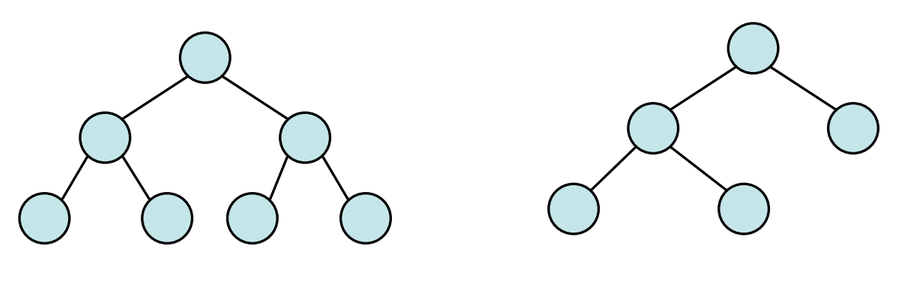

# Árvores AVL

Introduzidas em 1962 por Adel'son-Vel'skii e Landis, as árvores AVL são baseadas em árvores binárias de pesquisa, onde em cada operação de inserção e remoção efetuada, a árvore é balanceada. 

## Definição
Uma árvore binária T é dita AVL quando, para qualquer nó v de T, a diferença entre a altura das subárvores esquerda he(v) e direita hd(v) é no máximo em módulo igual a 1.

#### Exemplo de árvore AVL:

$$
|he(v) - hd(v)| \le 1
$$




```
OBS: Se uma árvore T é dita AVL, então todas as suas subárvores também são AVL
```

## Balanceamento
É dado pela altura da subárvore esquerda menos a altura da subárvore direita.

$$
    FB(v) = He(v) - Hd(v) 
$$


***Nós balanceados*** são aqueles onde os valores de FB são -1, 0 ou 1
```
FB(v):
    +1 subárvore esquerda mais alta que a direita
    0 lados iguais
    -1 subárvore direita mais alta que a esquerda
```
***Nós desbalanceados*** são aqueles onde os valores de FB são diferentes de 1, 0 ou -1
```
FB(v):
    > 1 subárvore esquerda está desbalanceando o nó v
    < -1 subárvore direita está desbalanceando o nó v
```


